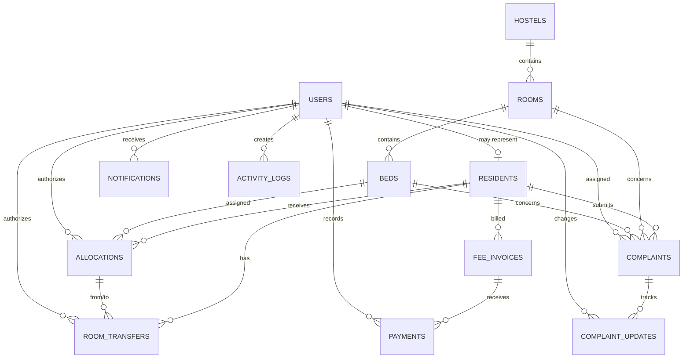

# Hostel Management System: Phase 1

## Proposed architecture

The application will use a React/Vite client, a FastAPI REST API, SQLAlchemy 2.x with Alembic, and MySQL 8/InnoDB. The API owns authorization, validation, transactions, reporting queries, and audit logging. The client consumes JSON endpoints and never calculates authoritative occupancy or financial values.

## Entity relationship diagram

## Table and business-rule specification

| Table | Primary key | Main foreign keys | Important rules |
|---|---|---|---|
| users | `id` | — | Unique email; role controls API permissions. |
| residents | `id` | `user_id -> users` | Unique roll number/email; inactive records are retained. |
| hostels | `id` | — | Unique hostel name. |
| rooms | `id` | `hostel_id -> hostels` | Room number unique within a hostel. |
| beds | `id` | `room_id -> rooms` | Bed number unique within a room; maintenance beds cannot be actively allocated. |
| allocations | `id` | resident, bed, authorizing user | Generated-column unique keys prevent two active allocations for one resident or bed. |
| room_transfers | `id` | resident, two allocations, authorizing user | Preserves old allocation and records the replacement allocation. |
| complaints | `id` | resident, optional room/bed, optional assignee | Priority/status/category are constrained enums. |
| complaint_updates | `id` | complaint, user | Immutable status history. |
| fee_invoices | `id` | resident | Unique invoice per resident and fee period; DECIMAL money. |
| payments | `id` | invoice, recording user | Unique payment reference; trigger prevents overpayment. |
| notifications | `id` | user | Users can only read their own notifications through the API. |
| activity_logs | `id` | optional user | Append-only audit trail for important operations. |

Allocation and transfer workflows must lock the relevant resident, bed, and invoice rows with `SELECT ... FOR UPDATE` inside one transaction. The database unique indexes remain the final concurrency safeguard.
